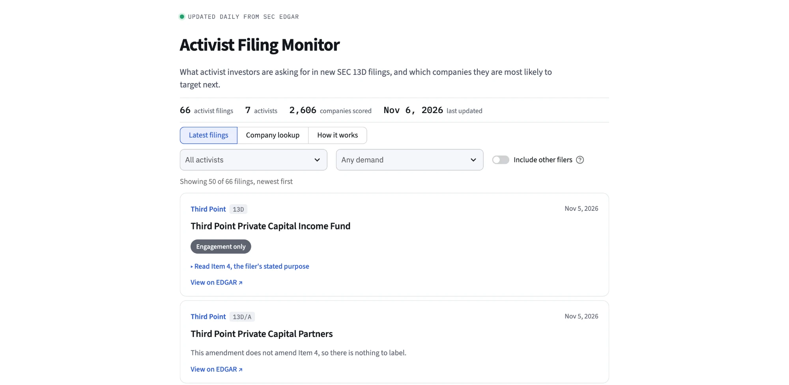

# Activist Filing Monitor

**Live app: https://activist-monitor.streamlit.app/**



Pulls new SEC Schedule 13D filings, extracts the Item 4 "Purpose of Transaction" text, and labels what
the activist is asking for (board seats, sale, buyback, and so on) using the Claude API. The web page shows each company's activist-risk score from the
[activist target screener](https://github.com/jamefoehner/activist-target-screener) next to its latest filings.

Status: deployed on Streamlit Community Cloud. A GitHub Action (`.github/workflows/refresh.yml`) runs the pipeline daily and commits any new filings to `data/feed.jsonl`, which redeploys the page. It needs two repository secrets: `SEC_USER_AGENT` and `ANTHROPIC_API_KEY`.

## Quick start

```bash
pip install -r requirements.txt
python -m pytest -q                                            # offline tests
python -m monitor.pipeline --offline tests/fixtures/0000902664-25-003788.txt   # extract only, no network
export SEC_USER_AGENT="Your Name you@school.edu"               # required by the SEC
export ANTHROPIC_API_KEY=...
python -m monitor.pipeline --limit 40                          # fetch, extract, label activist filers -> data/feed.jsonl
streamlit run app.py                                           # open the web page
```

## Layout

- `monitor/extract.py`: finds Item 4 in a filing (old HTML/text filings and the new structured XML format).
- `monitor/labeler.py`: ten-field labeling prompt, answer parser, Claude call with one retry.
- `monitor/edgar.py`: recent-filings feed and filing download, with a User-Agent, rate limit and disk cache.
- `monitor/pipeline.py`: ties them together and appends new filings to `data/feed.jsonl`.
- `monitor/activists.py` + `data/activists.txt`: only filings from these filers are labeled (edit the list).
- `monitor/data.py` and `app.py`: joins scores, past campaigns and the feed; Streamlit page.
- `data/`: precomputed screener scores and past-campaign results (derived from the screener project).

## Accuracy

Measured on 89 hand-labeled filings (original 13Ds from eight activists), with `claude-sonnet-5-5` on 2026-11-06
(`python scripts/eval_labeler.py`, results in `data/eval_results.json`):

| | Result (95% interval) |
|---|---|
| Macro-F1 over the ten categories | 0.84 (0.73 to 0.89) |
| All ten categories right | 76% (67% to 85%) |
| Always guessing "engagement only" | 45% all ten right, macro-F1 0.06 |

Weakest categories: governance (F1 0.53) and capital discipline (F1 0.64).
Caveats: several categories have fewer than ten test examples; the test filings are original 13Ds while most live
filings are amendments, so live accuracy may differ; one evaluation run on one model.

## Things to know

- Many 13D/A amendments don't amend Item 4. Those get `label_status: no_item4`, which means "nothing to label", not "no demands".
- The `not_a_demand` flag (sales, distributions, trust reports) is an addition to the validated ten-field prompt and has not been evaluated.
- The labeler is an LLM and can be wrong. In the research project, Claude Sonnet matched human labels on about 83% of filings.
- Research only, not investment advice.

## Data note

The scores and campaign returns in `data/` are derived results from my research project. They hold no raw
Compustat or CRSP records and no WRDS identifiers (gvkey, permno), prices, or fundamentals. The raw WRDS data is not in this repository.
